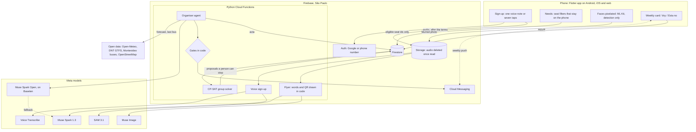
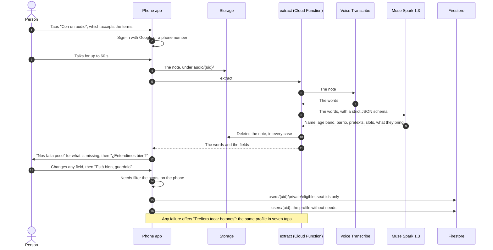
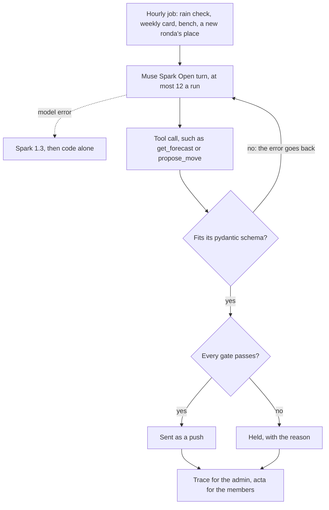

# Ronda

**Los mismos vecinos, a pocas cuadras, el mismo día todas las semanas. Vos decís "voy"; Ronda organiza el resto.**

*The same few neighbours, a few blocks from home, the same day every week. You say "voy"; Ronda does the rest.*

Ronda keeps the same small group of neighbours meeting every week around one pretext: mate on the
rambla, truco, fútbol 5. It is built in Ciudad de la Costa and Montevideo, Uruguay, for the
[Meta Global AI Developer Hackathon](https://cerebralvalley.ai/e/meta-ai-developer-hackathon)
(indie track, "Build for Your World"), 27 October – 4 November 2026. Before the window the repo
held only the design docs and the agents' setup (26 October, 13 commits, no code); every line of
code is from inside it, starting at [`8c379ec`](https://github.com/Cirorx/ronda/commit/8c379ec).

[Try it](#try-it) · [Architecture](#architecture) · [Meta models](#meta-models-in-ronda) ·
[Voice sign-up](#sign-up-by-voice-end-to-end) · [Organiser agent](#the-organiser-agent-and-its-gates) ·
[Running it](#running-it) · [Docs](#docs)

## Try it

- **Web app:** <https://ronda-uy.web.app/app/> (Android and iOS builds come from the same code).
  A new visitor gets "¿Cómo funciona?", with a sample of the weekly card, signs up by voice or
  by taps, sees what's near them, then signs in with Google or a phone number to keep the seat.
- **Video:** coming 4 November 2026.
- **To see a ronda with people in it:** run it on the emulators (§ [Running it](#running-it)):
  `scripts/reset.py` seeds 30 invented neighbours, and the admin screen (`/admin`) proposes
  groups from them and approves them. On the live project invented sign-ups never count, so a
  new member waits for real neighbours ("Todavía no tenés grupo").

## How it works

1. **Tell Ronda what you like and when you're free:** one voice note or seven short questions. No
   profile, no photo.
2. **Get a seat:** an open seat in a ronda nearby, or a new ronda that starts as soon as two
   neighbours want the same thing, and fills to six. A person sees every group and can stop it.
3. **The first time, someone waits for you:** a named member, at the spot. After the first meeting
   the group decides in private whether to keep going ("¿seguimos?").
4. **Same faces, same day, same place.** Ronda does the chores: the weekly "¿venís?", the rain
   plan, the bench when someone can't come, and the person you chose writing to you if you miss one.
5. **Then Ronda goes quiet.** The group should outlive the app.

Within 10 blocks (15 in Montevideo) · opens with 2 and fills to 6 (fútbol 5: 4 to 10) · bring one friend · same slot all season ·
leave or switch without explaining · free.

## Architecture

One Flutter app, one Firebase project in São Paulo, and every AI job on a Meta model. The phone
keeps what is sensitive; the server sees seat ids, counts and blurred photos.



The live transcription relay (`relay/`, Cloud Run) is built and off by default. Components, data
model and every job are in [`docs/ARCHITECTURE.md`](docs/ARCHITECTURE.md); packages and setup in
[`docs/STACK.md`](docs/STACK.md).

## Meta models in Ronda

Every AI job in Ronda runs on a Meta model, called from the Python functions (`functions/`). The
organiser agent runs on **Muse Spark Open**, Meta's open-weights model, served by Baseten, with
Spark 1.3 on the Meta Model API as its fallback. Measured from Uruguay on this repository's code,
2–3 November 2026, at Meta's and Baseten's listed prices; why each model, the number of calls
behind each figure and every fallback in full are in [`docs/MODELS.md`](docs/MODELS.md).

| Job | Model | Latency | Cost | If it fails |
|---|---|---|---|---|
| Hear a spoken sign-up | Muse Voice Transcribe | 2.3–3.9 s for a 10.5 s note | $0.0005 | Retries, then the sign-up by taps |
| Turn the words into sign-up fields | Muse Spark 1.3 (strict JSON schema) | 2.5–4.3 s | $0.0045 | The person edits the read-back; on an error, taps |
| Organiser agent: rain check, weekly card, bench, a new ronda's place and hour | Muse Spark Open on Baseten | 1.1–2.5 s a turn; 3–11 s a job | $0.005–0.027 a job | Spark 1.3, then code alone |
| Cut the group's things out of the host's photo | SAM 3.1 | 2.6–5.3 s a phrase | $0.0025 a phrase | "Probá con otra foto"; the tear-off flyer |
| Paint the flyer's background | Muse Image | 17.3–17.9 s | $0.01 | Retries, then the tear-off flyer |

What the code handles about each model:

- **Baseten doesn't enforce the schema for Spark Open.** It accepts each tool's JSON schema
  and passes through whatever the model writes, so every tool call is validated with pydantic
  in code. A call that doesn't fit gets the error back and one more turn: on 2026-11-02 the agent
  wrote an acta line over 200 characters, was told so, and wrote a shorter one. The weekly
  card's blocks are a pydantic catalog too; the model fills typed blocks and code builds the
  screen from them.
- **Spark Open answers in Markdown** (bold, in the first smoke test). Its words are
  Markdown-stripped before the gates read them, and the gates (no emoji, voseo, no money,
  nothing from 21:00 to 09:00) decide whether anything goes out.
- **SAM needs English nouns.** "termo", "mate" and "bizcochos" found nothing; "thermos" and
  "deck of playing cards" did, and the mates were found only as "pot" or "cup", never as "mate
  gourd". The code asks in English and tries the next phrase when one finds nothing; it fills
  the mate's mask from edge to edge, since SAM traces only its wall and would leave the yerba
  out, and asks for the bombilla on its own to join it to the mate it stands in.
- **Muse Image invents copy.** Asked for a poster's headline, it added a shop list, "Se fía" and
  "Desde 1978". So it paints only the picture, and every word on the flyer and its QR are drawn
  in code (Pillow, segno): no word on a flyer comes from a model.

**On the phone, without Meta.** Face detection is the one job that runs on a platform model,
because Meta has no model for it and a photo must not leave the phone with a face in it:
Google's ML Kit (`packages/face_blur`, Android and iOS) finds the faces, detection only, and the
phone pixelates them before upload. Speech recognition is always Voice Transcribe. No
text-to-speech ships in this build: reading a screen aloud is left to the phone's own screen
reader (TalkBack, VoiceOver), through the app's semantics labels.

## Sign-up by voice, end to end

One spoken minute becomes a profile. The audio lives only as long as the call that reads it, and
the needs never leave the phone.



## The organiser agent and its gates

The agent decides; code checks. A message reaches a phone only if every gate passes, and every
step is logged.



The gates, in code and in this order: 09:00 to 21:00 only, the first message says it is a
program, no emoji, voseo, no money, one routine push a week, public places only.

## Why

In Uruguay, one in four adults say they feel very lonely, and more than one in three under thirty
[1][2]. Almost a third of homes have just one person in them [3]. Friend apps seat you with new
strangers at every event [4]. Ronda does the opposite: the same faces, close to home, every week,
long enough for neighbours to become people you'd miss.

## Privacy by design: split by sensitivity

- **Needs stay on the phone.** "I can't walk far", "not after dark", "no car" are filters on the
  device. The server only ever learns which seats fit.
- **Voice is understood once.** Sent only after the person accepts short, plain terms; the audio
  is deleted as soon as it's read.
- **Faces are blurred on the phone** before any photo is uploaded. Detection only, never
  recognition.
- **The agent is a bot and says so.** Logistics only, quiet from 21:00 to 09:00, no emoji, and
  every action is written to a log members can read. These are rules in code, not in a prompt.
- **Matching never uses personality.** Only walking distance, time slot, activity and age band.

## What's built

All of this is in the code on `main`, with tests:

- **Sign-up by voice or by taps:** one spoken note read into the profile's fields, or seven short
  questions; a read-back to check every field; needs kept on the phone as seat filters. Sign-in
  with Google or a phone number.
- **Groups:** a CP-SAT solver (`solver/`) proposes rondas from slot, distance, pretext and age
  band; the admin screen approves them, or a ronda that formed itself goes ahead unless stopped
  in time, with its place, hour and host set by the organiser agent.
- **The weekly loop:** the weekly card on Mi ronda with [Voy] [Esta no], the RSVP push, the
  bench filling an empty seat, attendance ("¿Quién vino?"), "¿seguimos?" after the first meeting,
  the rain check and its proposal to move, and the acta: a log of everything the program did.
- **First visit and trust:** "Así va a ser" for a newcomer (who waits for them, where), a chosen
  person who writes when you miss one, and "Contar algo que pasó", read by a person.
- **Between meetings:** "Algo chico esta semana" (small plans, by voice or taps), ¿Dónde queda?
  (a barrio photo game, with people, plates and house numbers blurred) and the cuaderno del
  barrio (a private noticing log that stays on the phone).
- **Getting found:** the public "Cerca tuyo" page (<https://ronda-uy.web.app/>), the tear-off
  flyer with a QR per spot, and "Un mate de más", the flyer a host makes from a photo of the
  group's things.
- **Ajustes:** Mis datos, notifications, what Ronda keeps about you, sign out.
- **Built, off by default:** live transcription through `relay/`. **Not yet:** the in-app Cerca
  list, Truco's team draw, self-service data download and deletion (done by hand on request).

## Repo layout

```
lib/        the Flutter app, one folder per feature (Bloc, VGV layers)
packages/   data and repository packages, and ronda_ui (theme and shared widgets)
functions/  Python Cloud Functions: voice sign-up, organiser agent, flyers, the weekly loop
solver/     the CP-SAT group solver, pure Python
relay/      the live transcription relay (Cloud Run), off by default
hosting/    the public web pages: Cerca tuyo and the flyer's QR landing
firebase/   Firestore and Storage rules, indexes, and the rules' tests
flows/      Maestro UI flows (sign-up by taps and by voice, first visit)
evals/      model evals with recorded answers: voice, weekly card
scripts/    demo seed and reset (invented data in scripts/data/demo), flyers, model smoke tests, deploys
docs/       product, architecture, stack, models, design, glossary
```

Built with Claude Code; the rules its agents follow live in [`CLAUDE.md`](CLAUDE.md).

## Running it

You need Flutter 3.47, Python 3.13 with `uv`, Node and the Firebase CLI
([`docs/STACK.md`](docs/STACK.md) § Toolchain). The Firebase options files are not in the repo:
on a fresh clone run `flutterfire configure` per flavor (STACK.md § Native and project
checklist), or, for tests only, copy `tool/firebase_options_stub.dart` to
`lib/firebase_options_development.dart` and `lib/firebase_options_production.dart`, as CI does.

```sh
# The emulators, from the repo root (Firestore on 8088, Auth 9099, Functions 5001, UI on :4000).
# On macOS the variable keeps the Python functions' worker from crashing when it forks; to reach
# the real models from it also set no_proxy='*' and SSL_CERT_FILE (docs/STACK.md § Emulators).
OBJC_DISABLE_INITIALIZE_FORK_SAFETY=YES firebase emulators:start

# Invented demo data: 30 sign-ups, seat facts and places (scripts/seed.py 200 adds more)
FIRESTORE_EMULATOR_HOST=127.0.0.1:8088 FIREBASE_AUTH_EMULATOR_HOST=127.0.0.1:9099 \
  uv run --python 3.13 scripts/reset.py

# The app against the emulators (on a phone: --flavor development instead of -d chrome)
flutter run -d chrome -t lib/main_development.dart

# Make your account admin to reach /admin, then sign out and in again
FIREBASE_AUTH_EMULATOR_HOST=127.0.0.1:9099 uv run --python 3.13 scripts/set_admin.py <email>

# Tests
flutter test
uv venv --seed --python 3.13 functions/venv
VIRTUAL_ENV=functions/venv uv pip install -r functions/requirements.txt -r functions/requirements-dev.txt
(cd functions && venv/bin/pytest --cov)
(cd solver && uv sync && uv run pytest --cov)
(cd scripts && uv sync && uv run pytest)
(cd firebase/tests && npm ci && npm run test:emulator)
```

Model keys never go in the app. The functions read `MODEL_API_KEY` (Meta Model API) and
`BASETEN_API_KEY` from Cloud Functions config (Secret Manager), and the Montevideo bus API's
`MVD_API_CLIENT_ID` and `MVD_API_SECRET_ID` the same way; locally, the smoke tests and evals
read them from `.env`, which is never committed. Everything else, from push to pilot builds and
deploys, is in [`docs/STACK.md`](docs/STACK.md).

## Docs

- [`docs/PRODUCT.md`](docs/PRODUCT.md): every feature in the build, with the real UI copy
- [`docs/ARCHITECTURE.md`](docs/ARCHITECTURE.md): components, data model, solver, agent, privacy
- [`docs/STACK.md`](docs/STACK.md): packages, tools and setup
- [`docs/MODELS.md`](docs/MODELS.md): Meta models, partners and smoke tests
- [`docs/DESIGN.md`](docs/DESIGN.md): the look, "the barrio's own paper"
- [`docs/GLOSSARY.md`](docs/GLOSSARY.md): one word per domain concept
- [`solver/README.md`](solver/README.md): the group solver, its rules and its benchmark
- [`evals/README.md`](evals/README.md): how the models are checked, with recorded results

## Data and licences

- Weather: [Open-Meteo](https://open-meteo.com/) (CC BY 4.0)
- Bus timetables: Dirección Nacional de Transporte, metropolitan GTFS, via
  [catalogodatos.gub.uy](https://catalogodatos.gub.uy/) ("Licencia de DAG de Uruguay")
- Montevideo's city buses (the timetable, GTFS, and the next buses at a stop, live): the
  Intendencia de Montevideo's
  [public-transport API](https://api.montevideo.gub.uy/apidocs/publictransport), free with an
  account; it states no reuse licence and asks for no attribution, so we name it here
- Places, and the point of each Montevideo barrio (`scripts/montevideo_barrios.py`): ©
  [OpenStreetMap](https://www.openstreetmap.org/copyright) contributors (ODbL)
- All people and data in the mockups and seeds are invented.

## Sources

1. MSP / CIFRA, [*Percepción de la población sobre la salud mental y hábitos de consulta y tratamiento*](https://mediospublicos.uy/wp-content/uploads/2025/10/PERCEPCION-DE-LA-POBLACION-SOBRE-LA-SALUD-MENTAL-Y-HABITOS-DE-CONSULTA-Y-TRATAMIENTO.pdf),
   national telephone survey, n = 803, August 2025: 24% of adults score "very lonely"; 35% under 30.
2. Meta–Gallup, [*The Global State of Social Connections*](https://www.gallup.com/file/analytics/513347/Gallup-Meta-Global%20State%20of%20Social%20Connections%20Report-2023.pdf),
   2023: 25% of people in Uruguay feel very or fairly lonely.
3. INE, [Censo 2023: crecen los hogares unipersonales](https://www.gub.uy/instituto-nacional-estadistica/comunicacion/noticias/censo-2023-crecen-hogares-unipersonales),
   2024: 29.2% of households have one person.
4. Timeleft, [Timeleft Repeat](https://timeleft.com/post/timeleft-repeat-reconnect-with-friends/),
   December 2025: every dinner seats "new faces selected by our algorithm".

## Team

Ciro Gronrroz ([@Cirorx](https://github.com/Cirorx)), solo, Indie track.

## Licence

[MIT](LICENSE)
